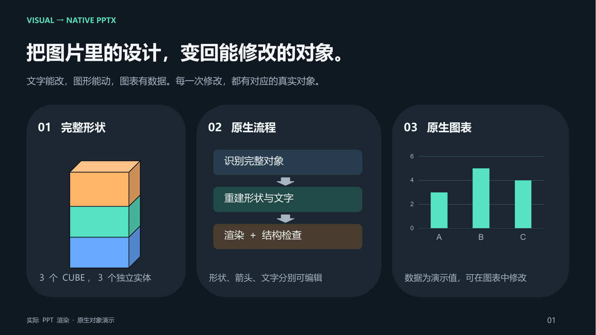

<div align="center">

# visual-to-native-pptx

### 一张好看的图，下一步应该是改得动的 PPT。

**把参考图片里的文字、图形与布局，重建成可以继续创作的 PowerPoint 对象。**

[查看实际效果](#实际效果) · [快速开始](#快速开始) · [下载示例 PPT](examples/native-objects-demo.pptx) · [阅读完整 Skill](skills/visual-to-native-pptx/SKILL.md)

</div>



你找到一张合适的参考图，想改标题、换颜色，再把中间那块挪开一点。

这时，PPT 里有没有一个真正的“中间那块”，就很重要。

`visual-to-native-pptx` 是给 Codex 使用的图片转可编辑 PPT skill。它指导 agent 识别完整对象，选择合适的原生形状，重建文字与布局，并检查生成文件的视觉效果和实际对象结构。

## 最有价值的一点：对象要还原对

**一个立方体，优先用一个完整立方体。三个立方体，就保留三个独立实体。**

这条规则解决了两种容易被效果图掩盖的问题：

| 参考图表达的内容 | 容易出现的做法 | 本 Skill 的要求 |
|---|---|---|
| 一个普通立方体 | 用三个四边形拼成三个面 | 优先使用一个原生 `CUBE`，调整尺寸和深度 |
| 三个堆叠立方体 | 一个高形状加两条线，看起来被切成三段 | 创建三个完整对象，各自可以选中、移动和改色 |
| 简单几何图标 | 不检查预设形状，直接拆成许多碎片 | 完整预设形状优先，确有需要才组合 |
| 图形里的文字 | 把文字留在截图或 PNG 中 | 重建为可编辑文本框 |

多形状组合仍有用途：特殊透视、各面独立样式等要求确实无法用完整形状表达时，可以使用必要的部件，并按对象分组。选择依据是对象的实际需要。

## 实际效果

### 移动一个对象，看结构是否真的还原了


左侧是三个完整原生立方体。右侧只把中间对象移出并改成紫色，顶部和底部保持各自的位置与颜色。打开 [示例 PPT](examples/native-objects-demo.pptx)，可以分别选中每个实体继续修改。

**两张图均来自实际生成的 `.pptx` 经 LibreOffice 渲染。** 示例按本 Skill 的规则制作，用于展示对象结构与编辑方式；它不是外部参考图复刻的独立性能测试。图表中的数值是演示数据。

示例文件已检查：第一页包含三个原生 `CUBE`、原生柱状图和可编辑文本框；第二页的两个对比区域各包含三个原生 `CUBE`。PPT 中没有栅格图片对象。

### 能继续改，才更有用

| 你接下来想做什么 | 重建结果应提供什么 |
|---|---|
| 改标题、标签或数字 | 原生文本框，可修改内容与样式 |
| 调颜色、线宽、圆角或位置 | 对应的原生形状与属性 |
| 移动或重新排列重复元素 | 保留各个独立对象 |
| 调整标准图表 | 优先使用 PowerPoint 原生图表 |
| 替换照片、复杂插画或 Logo | 独立图片素材，与文字、几何元素分开 |

## 快速开始

### 1. 安装到 Codex

在 Codex 中发送：

```text
请使用 skill-installer 安装 GitHub 仓库 chugwei/visual-to-native-pptx
中的 skills/visual-to-native-pptx。
```

也可以下载本仓库，把 `skills/visual-to-native-pptx` 文件夹放入个人技能目录：

| 环境 | 技能目录 |
|---|---|
| Windows | `%USERPROFILE%\.codex\skills` |
| macOS / Linux | `~/.codex/skills` |
| 设置了 `CODEX_HOME` | `$CODEX_HOME/skills` |

例如 Windows 安装后的文件应位于：

```text
C:\Users\你的用户名\.codex\skills\visual-to-native-pptx\SKILL.md
```

下一轮 Codex 对话即可调用。

### 2. 附上参考图片，告诉它你想还原什么

```text
使用 $visual-to-native-pptx，把这张参考图重建为一页可编辑 PPT。
保持原图比例、布局和文字内容。
几何元素优先使用完整原生形状，多个实体分别重建。
请渲染对比，并检查对象类型、数量和独立编辑能力。
```

如果参考图中的边界有歧义，补一句具体说明会更准确：

```text
图中是三个独立堆叠的立方体，每一个都要能单独移动和改色。
```

### 3. 拿到 PPT，继续创作

交付目标是一份 `.pptx`，以及确有需要的独立 PNG 素材。临时渲染、OCR 结果和调试文件不混入最终交付。

## 从图片到原生对象

```text
参考图片
    ↓
识别文字、完整对象及对象之间的关系
    ↓
选择完整预设形状 / freeform / 必要组合 / 独立图片
    ↓
重建布局、原生文本框与对象层级
    ↓
渲染对比 + 检查实际对象结构
    ↓
交付可继续编辑的 PPTX
```

适合页面截图、流程图、卡片布局、几何示意图、信息图和幻灯片设计稿。照片、复杂纹理和细节繁复的插画可保留为图片；文字和可重建的几何元素仍单独编辑。

这是一个 **agent 工作指南**，并非独立的图片转换程序。实际效果取决于参考图、所用模型、字体及生成和渲染工具；它要求检查结果，不承诺任意图片都能无损复刻。

## 仓库内容

```text
skills/visual-to-native-pptx/SKILL.md   完整 Skill 指令
assets/native-objects.png             原生对象演示的实际渲染图
assets/independent-editing.png        独立移动与改色的实际渲染图
examples/native-objects-demo.pptx     可下载、可编辑的两页示例
```

**带上你的参考图试一次。然后，选中那个你最想修改的对象。**
