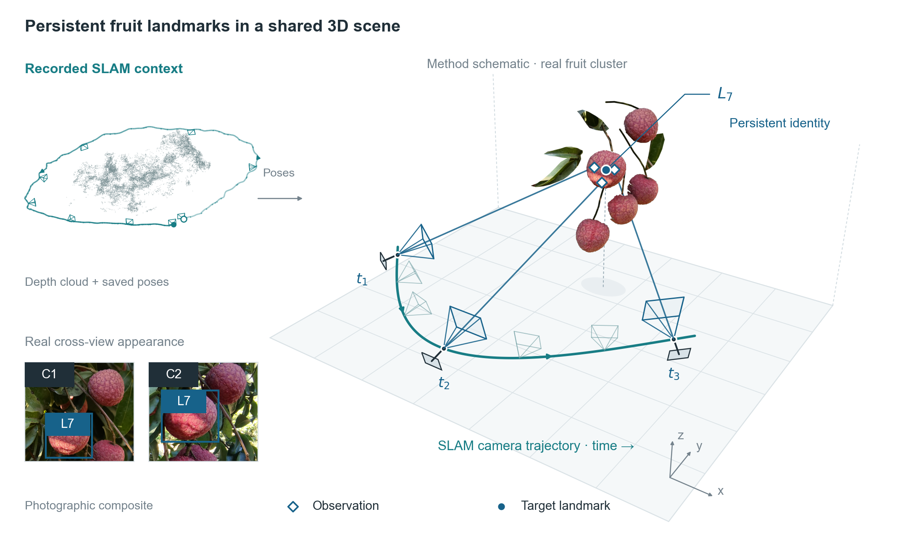
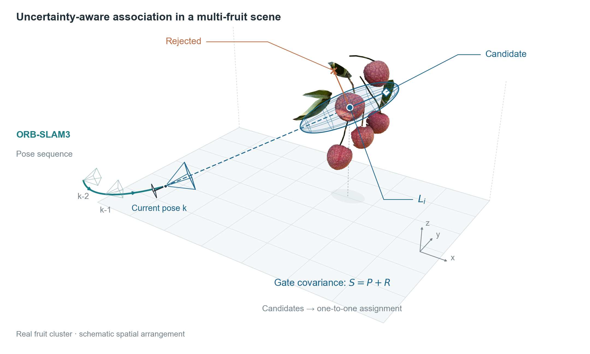
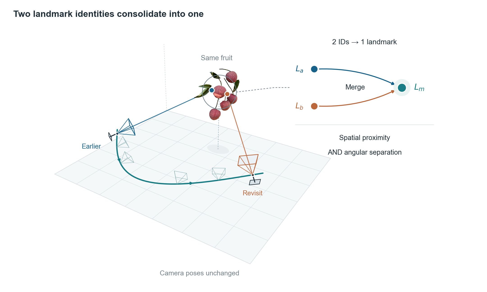
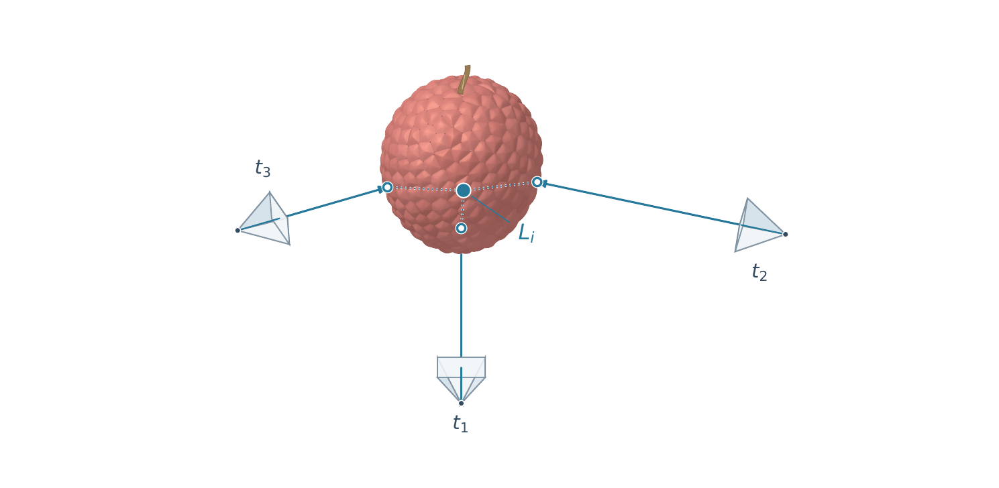
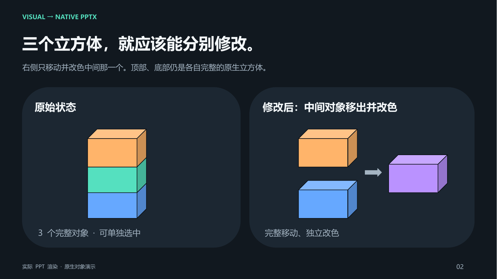

<div align="center">

# visual-to-native-pptx

### 让一张复杂科研图，成为下一次修改的起点。

**参考图 → 完整对象 → 可编辑 PowerPoint**

面向科研示意图、方法框架图与设计稿的 Codex Skill。
还原布局，也保留文字、图形、图片之间的编辑关系。

[看实际案例](#从真实科研图稿看重建需求) · [安装与使用](#安装与使用) · [完整指令](skills/visual-to-native-pptx/SKILL.md)

</div>



**相机换了视角，果实仍然是同一颗。图稿换了工具，你也应该能继续改。**

一张科研图里，可能同时有实拍素材、点云背景、空间网格、相机视锥、观测射线和数学标签。下一轮修改却往往很具体：把标签挪开一点，换一条轨迹的颜色，缩小局部说明，再把英文改成中文。

`visual-to-native-pptx` 为这类任务提供对象级的重建规则：识别完整实体，选择合适的 PowerPoint 原生形状，把文字重建为文本框，再检查视觉效果和实际对象结构。

## 从真实科研图稿看重建需求

这里选用了作者实际 Landmark 绘图工作的两组案例：**真实果簇与 SLAM 场景版**，以及**荔枝外观细化版**。案例原稿由已有科研绘图工作流生成，来源格式为 SVG/PDF，本仓库仅公开成果图片；原生 PPT 的独立编辑演示见后文。

### 01 · 同一颗果实，跨视角保持身份

首页图把三类信息放在同一幅画面里：左侧的点云与保存位姿、下方的实拍观察窗口，以及右侧的空间场景。相机、观测与目标路标用清晰的视觉层次连接起来。

重建这种图，关键是保留照片、几何关系和标注各自的编辑方式。

| 画面内容 | 在 PPT 中的重建目标 |
|---|---|
| 实拍荔枝、果簇、密集点云 | 保留为独立图片素材 |
| 空间网格、轨迹、观测射线 | 用原生线条、曲线和形状重建 |
| 相机视锥与方向符号 | 按完整符号组织必要的几何部件 |
| 路标点、观测标记、框选区域 | 保留独立形状，方便改色与定位 |
| 标题、图例、时间与身份标签 | 重建为原生文本框 |

[查看高清成果图](assets/landmark-persistent-identity.png)

### 02 · 让“候选”和“拒绝”在空间里一眼可见



这张图同时包含实拍果簇、相机运动、半透明空间范围、虚实线与候选标记。蓝色与橙色承担不同含义，图中的接受域、连线和标签需要保持对应。

**有用的重建结果，应允许你单独修改接受域、标记和文字，而不牵动整张图。** 曲面细节可以采用必要的可编辑曲线组合，实拍果簇保留为独立图片。

[查看高清成果图](assets/landmark-spatial-gate.png)

### 03 · 一张空间主图，一个紧凑的“2 → 1”说明



轨迹把“早期观察”与“再次回访”串起来；靠近果簇的局部说明把两个历史路标合为一个。图内使用定性的“空间接近 + 视角分离”，把具体阈值留给图注。

这种版式的价值在于主次明确：读者先理解空间关系，再看到身份合并。复刻时要保留轨迹、果簇、局部说明之间的位置与层级，让插图和标签能够继续调整。

[查看高清成果图](assets/landmark-revisit-merge.png)

### 04 · 有质感的素材，也能与可编辑几何共存



第二组案例用卵形轮廓、鳞状果皮、柔和光影和弯曲果梗表达荔枝外观。果皮材质保留为图片，周围的相机、射线、路标与标签在原稿中分别组织。

PPT 重建沿用这个分工：**复杂外观用独立素材，规则几何用原生形状，文字用文本框。** 这样既保留画面质感，也给后续编辑留下空间。

[查看高清成果图](assets/litchi-refined-identity.png)

以上是科研方法图稿；相机与空间关系包含示意内容，图稿不作为算法精度或计数性能证据。

## 这个 Skill 特别在意什么？

### 完整对象，优先用完整形状

一个普通立方体，优先使用一个原生 `CUBE`。三个独立堆叠的立方体，就创建三个完整对象。

不能把“形状优先”理解为无限拆碎：已有完整预设形状足以表达时，不用三个面片拼接；多个独立实体也不能合并成一个大形状，再加几条线模拟分段。特殊透视或各面独立样式确有需要时，允许必要组合，并按对象分组。

### 文字要能改，图片要能换

标题、图例、注释和标签重建为原生文本框。照片、复杂纹理和细节繁复的插画保持独立素材。纯色卡片、边框、箭头、分隔线等几何元素使用原生形状。

### 看效果，也检查文件里真的有什么

生成后重新渲染，检查布局、比例、换行和遮挡；同时检查形状类型、实体数量和分组。用户需要移动哪个对象，PPT 里就应有对应的可选对象。

## 原生 PPT 的独立编辑演示

<details>
<summary><strong>展开：把中间那个立方体单独移出并改色</strong></summary>



左、右两个区域各有三个独立 `CUBE`，右侧仅改变中间对象的位置与颜色。这是实际 `.pptx` 的渲染图，对象数量和类型已经检查。

[下载可编辑演示 PPT](examples/native-objects-demo.pptx)

</details>

## 安装与使用

### 安装到 Codex

直接在 Codex 中发送：

```text
请使用 skill-installer 安装 GitHub 仓库 chugwei/visual-to-native-pptx
中的 skills/visual-to-native-pptx。
```

也可以下载仓库，把 `skills/visual-to-native-pptx` 文件夹放入个人技能目录：

| 环境 | 技能目录 |
|---|---|
| Windows | `%USERPROFILE%\.codex\skills` |
| macOS / Linux | `~/.codex/skills` |
| 设置了 `CODEX_HOME` | `$CODEX_HOME/skills` |

下一轮对话即可调用。

### 附上参考图，给出你的重建目标

```text
使用 $visual-to-native-pptx，把这张科研示意图重建为一页可编辑 PPT。
保持原图比例、布局、文字及空间关系。
照片与复杂纹理保留为独立素材；轨迹、网格、箭头、标记和文字分别重建。
完整原生形状优先，多个实体分别创建。
完成后渲染对比，并检查对象类型、数量和独立编辑能力。
```

需要特别保留的含义，直接补充一句：

```text
局部插图表示两个路标合并为一个；相机轨迹保持不变。
```

交付目标是一份 `.pptx`，以及确有需要的独立 PNG 素材。实际还原效果取决于参考图、模型、字体和生成工具；本仓库提供 agent 工作指南。

## 文件入口

- [完整 Skill](skills/visual-to-native-pptx/SKILL.md)
- [Landmark 持续身份成果图](assets/landmark-persistent-identity.png)
- [空间关联成果图](assets/landmark-spatial-gate.png)
- [回访合并成果图](assets/landmark-revisit-merge.png)
- [荔枝外观细化成果图](assets/litchi-refined-identity.png)
- [可编辑 PPT 演示](examples/native-objects-demo.pptx)
- [案例来源与格式说明](examples/CASE_SOURCES.md)

**带上你的参考图。让下一轮修改，发生在真正的对象上。**
